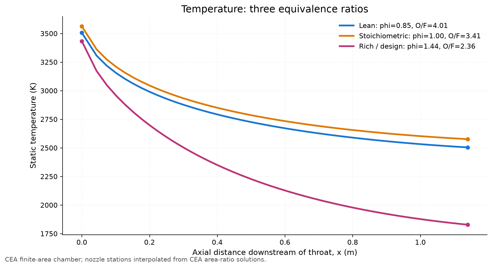
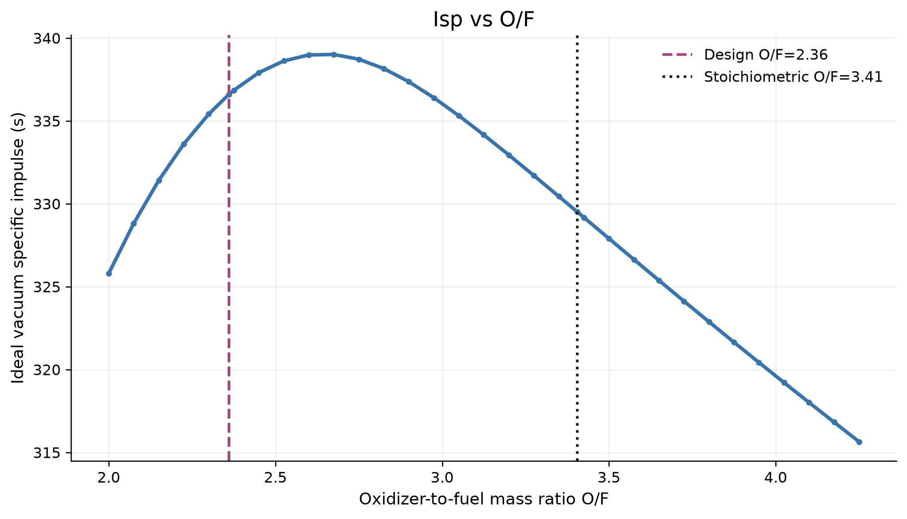

# Merlin 1D — Thermodynamic & Chemical Modeling with NASA CEA

Quasi-1D equilibrium modeling of an RP-1/LOX rocket engine with parameters inspired by SpaceX Merlin 1D, using the NASA CEA Python API.

## Overview
- Three equivalence ratios: Lean (φ=0.85), Stoichiometric (φ=1.00), Rich/Design (φ=1.44)
- Fixed chamber pressure (97 bar) and fixed nozzle geometry across cases
- Outputs: chamber/throat/exit T and P, species mole fractions, Isp, and thrust vs altitude

## Assumptions & Limitations
- **Engine geometry is assumed**, not confirmed SpaceX proprietary dimensions.
- Quasi-1D ideal equilibrium; no friction, heat loss, nozzle separation, or transients.
- RP-1 modeled as empirical C1H1.95; stoichiometric O/F is approximate.
- The 845 kN sea-level thrust is the SpaceX published reference, not a model output.

## Results (highlights)
- Isp peak near O/F ≈ 2.67 (≈339 s ideal vacuum)
- Rich/design point (O/F=2.36) is cooler at chamber and exit
- H2O mole fraction rises then slightly drops along the nozzle




## How to Run
```bash
pip install -r requirements.txt
python CEA_improved.py
```


Results are written to merlin_cea_results/.

## References
- NASA CEA Python API: https://nasa.github.io/cea/

- SpaceX Falcon User's Guide (2025)